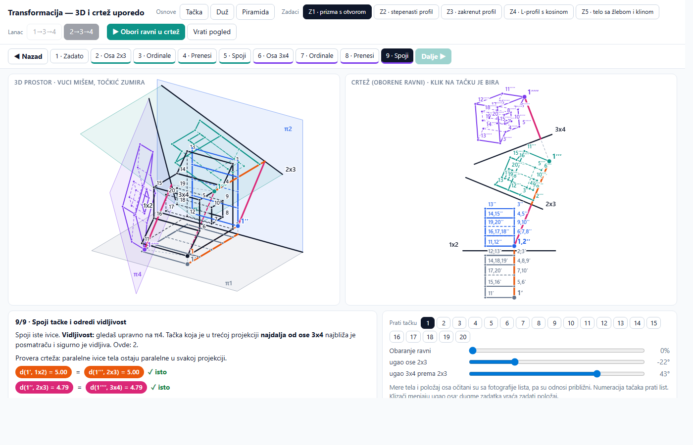
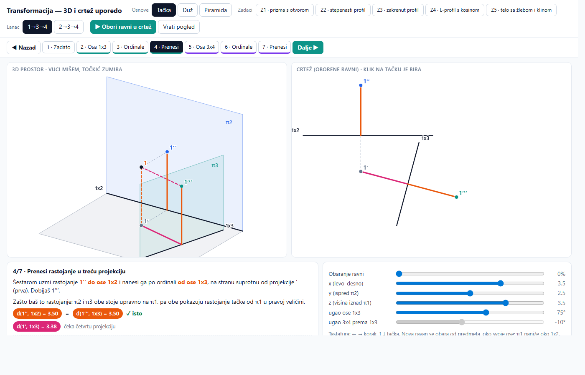
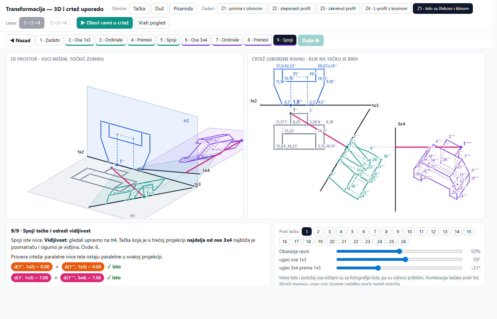

# Transformacija i vidljivost — 3D i crtež uporedo

Interaktivna stranica za učenje **transformacije** (uvođenja novih ravni projekcije) i **pravila vidljivosti ivica** (šta je bliže a šta dalje, puna ili isprekidana linija) u nacrtnoj geometriji. Levo je predmet u 3D prostoru sa ravnima projekcije, desno isti predmet na crtežu. Sve se menja uporedo, korak po korak.

**Otvori:** https://3esign.github.io/nacrtna-3d/



## Pravila koja stranica uči

### 1. Pravilo prenošenja tačke u novu projekciju

> Udaljenost nove projekcije od nove ose jednaka je udaljenosti zamenjene projekcije od stare ose.

- **Pravac ordinale:** iz projekcije koja ostaje, upravno na novu osu.
- **Udaljenost:** iz projekcije koja se zamenjuje, merena od stare ose (preskače se jedan korak unazad).
- **Strana ose:** tačke koje su bile s iste strane stare ose ostaju s iste strane nove.

### 2. Pravila vidljivosti — kako znamo šta je bliže, a šta dalje (puna ili isprekidana)

Dubina za posmatranu projekciju ($\pi_1, \pi_2, \pi_3$ ili $\pi_4$) čita se u **susednoj projekciji preko zajedničke ose**, gledajući **ka osi**:

1. **Zlatno pravilo („dalje od ose = bliže oku“):** tačka koja je u susednoj projekciji **dalja od zajedničke ose** u prostoru je **bliža posmatraču** (vidi se → **puna**); tačka **bliža zajedničkoj osi** je **dalja, iza tela** (**isprekidana**).
2. **Kontura je uvek puna:** spoljni obris projekcije nikad nije zaklonjen.
3. **Najbliže i najdalje teme:** iz najisturenijeg temena (najdaljeg od ose u susednoj projekciji) kreću vidljive ivice; u zaklonjeno teme uz samu osu ulaze isprekidane.
4. **Presek mimoilaznih ivica (konkurentne tačke):** gde se dve unutrašnje ivice na crtežu seku, vrati ordinalu u susednu projekciju — ivica **dalja od ose** je bliža oku (**puna**), a bliža osi je iza nje (**isprekidana**).

## Šta ima

| Deo | Opis |
|---|---|
| Osnove | tačka, duž i piramida (sa punom 3D vidljivošću ivica i klizačima za položaj i uglove osa) |
| Zadaci | pet tela (Z1–Z5) sa numerisanim temenima, lanci 1→3→4 i 2→3→4 |
| Koraci | zadato → osa → ordinale → prenesi → spoji i vidljivost, za $\pi_3$ i $\pi_4$ |
| Inspektor vidljivosti | klik na bilo koju ivicu prikazuje strelicu pogleda, zrak zaklanjanja („ispred / iza“) i tačno pravilo zašto je puna, isprekidana ili delimično vidljiva |
| Vežba prenosa i vidljivosti | 1) sam klikneš gde ide tačka; 2) sam određuješ da li je ivica puna ili isprekidana (uz dugme „Reši konturu“ i dijagnostiku svake greške) |
| Obaranje i šestar | kontinualno 3D obaranje ravni u crtež i animacija prenosa rastojanja šestarom |





## Upravljanje

- **Miš / dodir:** vučenje okreće 3D prikaz (dva prsta zumiraju), klik na tačku ili ivicu u crtežu je bira.
- **Tastatura:** `← →` menja korak, `↑ ↓` menja tačku ili ivicu.
- **Adresa:** stanje se može zadati u linku, npr. `#obj=z3&k=5&edge=3-8`, `#obj=z3&k=9&vquiz=1` ili `#obj=z1&k=9`.

## Pokretanje i provera

Stranica je jedan fajl (`index.html`), bez zavisnosti i bez gradnje.

```
node test/provera.cjs
```

Skripta čita račun iz `index.html` i proverava:
1. Na 4.000 slučajnih položaja (oba lanca) pravilo prenošenja daje isto što i prava 3D projekcija.
2. Kod svih zadataka (`Z1–Z5`) temena i ivice leže na površini tela, a poklapanja odgovaraju listovima.
3. Egzaktna vidljivost, detekcija spoljne konture, poredak dubine („dalje od ose = bliže oku“) i konkurentni preseci važe u sve četiri projekcije (`π1–π4`).

## Autor i licenca

© 2026 **dr Poturak Semir**. Kod je pod licencom [MIT](LICENSE).

Predlog navođenja: Poturak, S. (2026). *Transformacija — 3D i crtež uporedo: interaktivno učenje nacrtne geometrije*. https://github.com/3esign/nacrtna-3d
